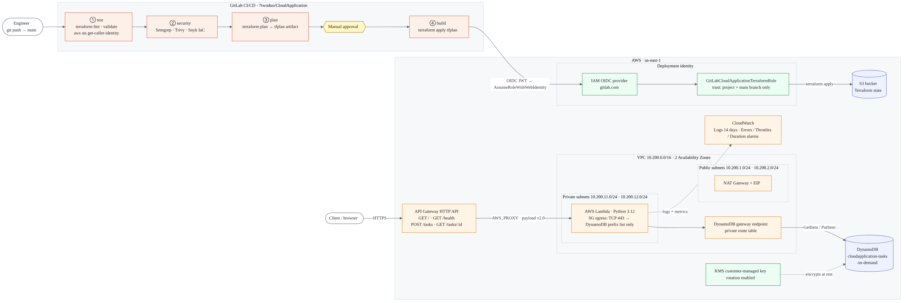
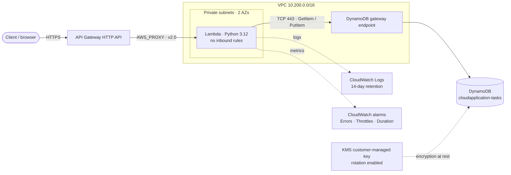
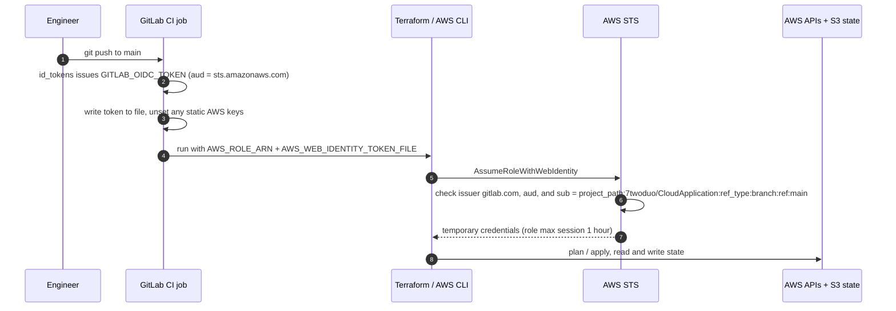

# 🛡️ FedRAMP-Aligned Serverless Task API on AWS with a GitLab DevSecOps Pipeline

<p align="center">
  
</p>

<p align="center">
  A production-inspired cloud security project: a Lambda-backed Task API running in private subnets, storing data in a KMS-encrypted DynamoDB table, and shipped through a GitLab pipeline that authenticates to AWS with OIDC and must pass Semgrep, Trivy, and Snyk gates plus a manual approval before Terraform applies anything.
</p>

<p align="center">
  
  
  
  
  
  
</p>

<p align="center">
  
</p>

---

## 📋 Table of Contents

- [📌 Lab Objective](#-lab-objective)
- [🧠 Problem Statement](#-problem-statement)
- [🏗️ Architecture](#️-architecture)
- [📊 Architecture Diagram](#-architecture-diagram)
- [🖥️ Project Overview](#️-project-overview)
- [🧰 Requirements](#-requirements)
- [📁 Project Structure](#-project-structure)
- [⚙️ Implementation Steps](#️-implementation-steps)
- [🧪 Validation & Testing](#-validation--testing)
- [🏢 Enterprise Architecture Mapping](#-enterprise-architecture-mapping)
- [🔐 Security Architecture](#-security-architecture)
- [📊 Observability](#-observability)
- [🔁 CI/CD Pipeline](#-cicd-pipeline)
- [⚖️ Scaling Considerations](#️-scaling-considerations)
- [💰 Cost Considerations](#-cost-considerations)
- [🧩 Multi-Service Expansion](#-multi-service-expansion)
- [🛠️ Engineering Decisions](#️-engineering-decisions)
- [🚧 Current Limitations](#-current-limitations)
- [📸 Artifacts](#-artifacts)
- [🧹 Teardown](#-teardown)
- [🧠 Lessons Learned](#-lessons-learned)
- [🧪 Troubleshooting](#-troubleshooting)
- [📚 References](#-references)
- [👥 Author](#-author)

---

## 📌 Lab Objective

Build and ship a small, real serverless API through a **gated, keyless CI/CD pipeline**, so that:

- **no AWS access keys are stored anywhere**: GitLab authenticates to AWS with short-lived OIDC credentials
- **every change is formatted, validated, security-scanned, planned, and manually approved** before Terraform touches AWS
- **the running workload follows least privilege**: private subnets, no inbound access, one-table IAM permissions, and network egress only to DynamoDB
- **data at rest is encrypted** with a customer-managed KMS key that rotates automatically
- **errors, throttling, and slow executions raise CloudWatch alarms**

> [!NOTE]
> This is a **FedRAMP-aligned design exercise**, not a FedRAMP authorization package. It applies the same ideas assessors look for (least privilege, boundary protection, encryption, change control, vulnerability scanning, audit evidence) to a scope small enough to build, test, and explain end to end.

---

## 🧠 Problem Statement

Small internal APIs are often the least-governed workloads in a cloud account. They are commonly shipped with:

- long-lived AWS access keys pasted into CI/CD variables
- deployments run from an engineer's laptop with no review step
- security scanning added "later", or never
- Lambda functions with wildcard IAM permissions
- functions that can reach the whole internet even though they only talk to one database
- no alarms, so failures are discovered by users

That creates real security and compliance risk:

- **credential leakage**: a static key in CI is a standing credential that never expires
- **unreviewed change**: no evidence of who approved what, or what exactly was applied
- **excess privilege**: one bug or dependency compromise can reach far beyond the app's data
- **weak audit readiness**: no clean trail from commit → scan → plan → approval → apply

This project shows how to close those gaps with controls that cost very little to adopt.

---

## 🏗️ Architecture

The system is split into three planes.

| Plane | Responsibility | Components |
|---|---|---|
| **Delivery plane** | Turns a `git push` into a reviewed, approved Terraform apply | GitLab CI/CD, GitLab OIDC ID token, IAM OIDC provider, IAM deployment role, S3 Terraform state |
| **Runtime plane** | Serves the Task API | API Gateway HTTP API, Lambda in private subnets, DynamoDB gateway endpoint, DynamoDB table, KMS key |
| **Observability plane** | Records behavior and raises alarms | CloudWatch Logs, CloudWatch metric alarms, CloudTrail event history, GitLab job logs |

### 🔄 Request Flow

```text
Client / browser
   │  HTTPS
   ▼
API Gateway HTTP API  ($default stage, auto-deploy)
   │  AWS_PROXY integration · payload format 2.0 · 10 s timeout
   ▼
AWS Lambda  (Python 3.12 · 128 MB · 10 s)  ── ENIs in 2 private subnets / 2 AZs
   │  TCP 443, allowed ONLY to the DynamoDB managed prefix list
   ▼
DynamoDB gateway VPC endpoint  (route on the private route table)
   │
   ▼
DynamoDB table "cloudapplication-tasks"  ── encrypted with a customer-managed KMS key
```

### 🚚 Delivery Flow

```text
git push → main
   │
   ▼
test      terraform fmt -check · terraform validate · aws sts get-caller-identity
   │
   ▼
security  Semgrep (ERROR) · Trivy (HIGH/CRITICAL) · Snyk IaC (high and above)
   │
   ▼
plan      terraform plan -out=tfplan   →  artifacts: tfplan + lambda_function.zip
   │
   ▼
⏸  manual approval  (pipeline is "blocked" until a human runs the job)
   │
   ▼
build     terraform apply tfplan   →  applies exactly what was reviewed
```

### 🌐 Network Layout

| Subnet | CIDR | Availability Zone | Route Table | Contents |
|---|---|---|---|---|
| `legend-vpc-public-1` | `10.200.1.0/24` | 1st available AZ | Public → Internet Gateway | NAT Gateway + Elastic IP |
| `legend-vpc-public-2` | `10.200.2.0/24` | 2nd available AZ | Public → Internet Gateway | Reserved for future public resources |
| `legend-vpc-private-1` | `10.200.11.0/24` | 1st available AZ | Private → NAT + DynamoDB endpoint | Lambda ENIs |
| `legend-vpc-private-2` | `10.200.12.0/24` | 2nd available AZ | Private → NAT + DynamoDB endpoint | Lambda ENIs |

> The VPC CIDR is `10.200.0.0/16`. Availability Zones are picked at plan time from the first two available AZs in the region.

---

## 📊 Architecture Diagram

The image at the top of this README is [`diagrams/architecture-diagram.png`](./diagrams/architecture-diagram.png). To use a Lucidchart or draw.io export instead, save it at the same path.

The diagrams below are Mermaid, so they render directly on GitLab and GitHub.

### Runtime View



### Deployment Identity (OIDC) View



---

## 🖥️ Project Overview

The application is a deliberately small **Task API**: create a task with a title, fetch it by ID, and check service health. The same Lambda also serves a **browser test page** at `/` with one button per route, including the error cases, so the API can be exercised without Postman or curl.

> [!IMPORTANT]
> The app is intentionally simple. The engineering value is in **how it is delivered and isolated**: keyless deployments, security gates, reviewed plans, private networking, scoped IAM, customer-managed encryption, and alarms, all defined as code.

### ✅ What This Builds

✅ A custom **VPC** with public and private subnets across **2 Availability Zones**  
✅ An **Internet Gateway**, a **NAT Gateway** with an Elastic IP, and public/private route tables  
✅ A **DynamoDB gateway VPC endpoint** attached to the private route table  
✅ A **customer-managed KMS key** (rotation enabled) with the alias `alias/cloudapplication-dynamodb`  
✅ An on-demand **DynamoDB table** (`cloudapplication-tasks`) encrypted with that key  
✅ A **Lambda function** (`legend-vpc-tasks`) deployed into both private subnets  
✅ A Lambda **execution role** limited to `GetItem` / `PutItem` on one table and use of one KMS key  
✅ A Lambda **security group** with no inbound rules and egress only to DynamoDB on TCP 443  
✅ An **API Gateway HTTP API** with four routes and an invoke permission scoped to this API  
✅ A **CloudWatch log group** with 14-day retention and **3 metric alarms**  
✅ A one-time **bootstrap stack**: GitLab OIDC provider + IAM role trusted only by this project's `main` branch  
✅ A **GitLab pipeline** with test, security, plan, and manually approved build stages, plus a separate manual destroy workflow

### 🧱 Core AWS Resources

| AWS Resource | Role in Architecture |
|---|---|
| **Amazon VPC** | Network boundary for the workload (`10.200.0.0/16`) |
| **Public / Private Subnets** | Tiered segmentation; the Lambda runs only in private subnets |
| **Internet Gateway + NAT Gateway** | Internet egress path for private subnets (not used by the current Lambda; see [Cost Considerations](#-cost-considerations)) |
| **DynamoDB Gateway Endpoint** | Keeps Lambda → DynamoDB traffic on the AWS network through a private route |
| **Amazon API Gateway (HTTP API)** | Public HTTPS entry point and route matching |
| **AWS Lambda** | Request handling, input validation, and DynamoDB reads/writes |
| **Amazon DynamoDB** | Task storage, on-demand capacity, keyed by `id` |
| **AWS KMS** | Customer-managed key for DynamoDB encryption at rest, with automatic rotation |
| **AWS IAM** | Lambda execution role, GitLab OIDC provider, and the CI deployment role |
| **Amazon CloudWatch** | Lambda logs and alarms for errors, throttles, and duration |
| **Amazon S3** | Remote Terraform state (existing bucket, encrypted) |

### 🔌 API Routes

| Method | Route | Purpose | Success | Error Responses |
|---|---|---|---|---|
| `GET` | `/` | Browser test page with buttons for every route | `200` HTML | none |
| `GET` | `/health` | Liveness check | `200 {"status": "ok"}` | none |
| `POST` | `/tasks` | Create a task from `{"title": "..."}` | `201` task object | `400` invalid JSON, non-object body, missing/blank title, title over 200 chars · `500` database error |
| `GET` | `/tasks/{id}` | Fetch one task | `200` task object | `404` task not found · `500` database error |

Example task object:

```json
{
  "id": "6f1d2c8e-3b0a-4c39-9f0e-2a7d5d7e9b41",
  "title": "Patch the login bug",
  "status": "OPEN",
  "created_at": "2026-10-29T05:30:00.000000+00:00"
}
```

Input validation rules enforced by the Lambda:

- the request body must be valid JSON **and** a JSON object
- `title` must be a string that is not blank after trimming whitespace
- `title` may be at most **200 characters**
- `id` is always a server-generated UUIDv4, `status` starts as `OPEN`, and `created_at` is UTC ISO-8601
- errors are returned as `{"error": "<message>"}`; DynamoDB exceptions are logged with a stack trace but return only a generic `500` message

### 🧰 Technology Stack

<p align="center">
  
  
  
  
  
  
  
  
  
  
  
  
  
  
</p>

| Category | Technologies |
|---|---|
| **Cloud Provider** | AWS (`us-east-1`) |
| **Infrastructure as Code** | Terraform `>= 1.5.0` (pipeline image `hashicorp/terraform:1.12.2`), AWS provider `~> 6.0`, Archive provider `~> 2.8` |
| **Networking** | VPC, public/private subnets, Internet Gateway, NAT Gateway, route tables, DynamoDB gateway endpoint, managed prefix list |
| **API & Compute** | API Gateway HTTP API, AWS Lambda (Python 3.12, boto3) |
| **Data & Encryption** | DynamoDB (on-demand), KMS customer-managed key with rotation |
| **CI/CD** | GitLab CI/CD, GitLab OIDC ID tokens, manual approval jobs |
| **Security Scanning** | Semgrep (SAST), Trivy (vulnerabilities, misconfigurations, secrets, licenses), Snyk IaC |
| **Monitoring** | CloudWatch Logs, CloudWatch metric alarms |
| **State** | S3 backend with server-side encryption |

### ✨ What This Project Demonstrates

<table>
  <tr>
    <td align="center" width="33%">
      <h3>🔑 Keyless Deployments</h3>
      GitLab exchanges a short-lived OIDC token for temporary AWS credentials. No access keys exist in CI.
    </td>
    <td align="center" width="33%">
      <h3>🚦 Security Gates</h3>
      SAST, dependency, IaC, secret, and license scanning must pass before a plan is even created.
    </td>
    <td align="center" width="33%">
      <h3>✋ Reviewed Changes</h3>
      A saved plan is reviewed, then a human approves the apply. What gets applied is exactly what was reviewed.
    </td>
  </tr>
  <tr>
    <td align="center" width="33%">
      <h3>🧱 Private Workload</h3>
      Lambda runs in private subnets with zero inbound rules and egress only to DynamoDB.
    </td>
    <td align="center" width="33%">
      <h3>🔒 Least-Privilege IAM</h3>
      Two DynamoDB actions on one table, KMS use on one key, and an invoke permission scoped to one API.
    </td>
    <td align="center" width="33%">
      <h3>🗝️ Customer-Managed Encryption</h3>
      DynamoDB data is encrypted with a KMS key the account controls, with automatic rotation.
    </td>
  </tr>
  <tr>
    <td align="center" width="33%">
      <h3>📈 Alarms by Default</h3>
      Errors, throttles, and near-timeout executions each have a CloudWatch alarm.
    </td>
    <td align="center" width="33%">
      <h3>🧯 Safe Teardown</h3>
      Destroy is a separate, manual, confirmed workflow that also produces a reviewable plan.
    </td>
    <td align="center" width="33%">
      <h3>🛠️ Repeatable Infrastructure</h3>
      Every resource, including the CI trust relationship, is defined in Terraform.
    </td>
  </tr>
</table>

---

## 🧰 Requirements

### Tools

| Tool | Version | Used For |
|---|---|---|
| **Terraform** | `>= 1.5.0` | Bootstrap stack and local runs (the pipeline uses `1.12.2`) |
| **AWS CLI** | v2 | Bootstrap, validation commands, log tailing |
| **Git** | any recent | Pushing to GitLab |
| **curl** | any | API testing |
| **jq** | optional | Extracting the task ID in test commands |

### Accounts & Access

| Requirement | Notes |
|---|---|
| **AWS account** | Region `us-east-1` by default |
| **Existing S3 bucket for Terraform state** | Not created by this repo. Set its name in `1-main.tf` |
| **Local AWS credentials with IAM admin rights** | Needed **once** to apply the `bootstrap/` stack (creates the OIDC provider and deployment role) |
| **GitLab project** | Defaults to `7twoduo/CloudApplication`; change `gitlab_project_path` in `bootstrap/variable.tf` for your own |
| **Snyk account** | API token and organization ID for the `snyk-iac` job |

### GitLab CI/CD Variables

Set these under **Settings → CI/CD → Variables**:

| Variable | Value | Used By | Recommendation |
|---|---|---|---|
| `AWS_ROLE_ARN` | `terraform -chdir=bootstrap output -raw gitlab_role_arn` | `aws-identity`, `plan-infrastructure`, `build-infrastructure`, destroy jobs | Protected |
| `SNYK_TOKEN` | Snyk API token | `snyk-iac` | Masked. Only mark Protected if every branch that runs scans is protected |
| `SNYK_ORG_ID` | Snyk organization ID | `snyk-iac` | Masked |

Already defined in `.gitlab-ci.yml` (no action needed): `AWS_DEFAULT_REGION=us-east-1`, `TF_IN_AUTOMATION=true`, `TF_INPUT=false`, `TF_STATE_NAME`.

### Terraform Variables

| Stack | Variable | Default | Description |
|---|---|---|---|
| Root | `aws_region` | `us-east-1` | Region for all resources |
| Root | `project_name` | `legend-vpc` | Name prefix for VPC, Lambda, API, security group, and alarms |
| Bootstrap | `gitlab_project_path` | `7twoduo/CloudApplication` | Only this GitLab project can assume the role |
| Bootstrap | `gitlab_branch` | `main` | Only this branch can assume the role |
| Bootstrap | `role_name` | `GitLabCloudApplicationTerraformRole` | Name of the CI deployment role |

### Terraform Outputs

| Output | Description |
|---|---|
| `api_endpoint` | Public HTTPS endpoint of the Task API |
| `lambda_function_name` / `lambda_function_arn` | Task API function |
| `tasks_table_name` / `tasks_table_arn` | DynamoDB table |
| `tasks_kms_key_arn` | Customer-managed key encrypting the table |
| `vpc_id`, `availability_zones` | Network identifiers |
| `internet_gateway_id`, `nat_gateway_id` | Gateway identifiers |
| `public_route_table_id`, `private_route_table_id` | Route table identifiers |
| `gitlab_role_arn` *(bootstrap)* | Value for the `AWS_ROLE_ARN` CI/CD variable |

---

## 📁 Project Structure

```text
CloudApplication/
├── .gitlab-ci.yml               # Pipeline: test → security → plan → manual build
├── destroy.yml                  # Included workflow: manual plan-destroy → confirmed destroy
├── .gitignore                   # Ignores state, tfvars, .terraform*, and the Lambda zip
│
├── 1-main.tf                    # Backend + providers, VPC, subnets, IGW, NAT, route tables,
│                                # KMS key + alias, DynamoDB table, DynamoDB gateway endpoint
├── 2-lambda.tf                  # Lambda packaging, execution role, scoped IAM policy,
│                                # security group, function in private subnets
├── 3-api.tf                     # HTTP API, Lambda proxy integration, routes, stage,
│                                # API-scoped invoke permission
├── 4-monitoring.tf              # Log group (14-day retention) + Errors/Throttles/Duration alarms
├── variable.tf                  # Region, name prefix, AZ lookup, shared locals and tags
├── output.tf                    # Network, DynamoDB, KMS, Lambda, and API outputs
│
├── src/
│   └── lambda_function.py       # Task API handler + built-in browser test page
│
├── bootstrap/                   # Run once, locally: CI trust relationship
│   ├── main.tf                  # GitLab OIDC provider, trust policy, deployment role
│   ├── variable.tf              # GitLab project path, branch, role name
│   └── output.tf                # gitlab_role_arn → AWS_ROLE_ARN
│
├── diagrams/
│   └── architecture-diagram.png # Architecture diagram used at the top of this README
│
└── README.md

# Generated locally, git-ignored:
#   lambda_function.zip          # Built by data.archive_file during terraform plan
#   .terraform/, .terraform.lock.hcl, *.tfstate
```

---

## ⚙️ Implementation Steps

### Option A: Deploy Through the GitLab Pipeline (recommended)

**1. Clone the repository**

```bash
git clone https://gitlab.com/7twoduo/CloudApplication.git
cd CloudApplication
```

**2. Point Terraform at your state bucket**

Open `1-main.tf` and change the bucket name to an S3 bucket you own:

```hcl
backend "s3" {
  bucket  = "deathless-godx" # Change this
  key     = "environments/production/terraform.tfstate"
  region  = "us-east-1"
  encrypt = true
  #  use_lockfile = true
}
```

**3. Bootstrap the OIDC trust (one time, from your machine)**

If you forked the project or use a different branch, update `gitlab_project_path` and `gitlab_branch` in `bootstrap/variable.tf` first.

```bash
cd bootstrap
terraform init
terraform apply
terraform output -raw gitlab_role_arn
cd ..
```

> The bootstrap stack keeps **local** state (`bootstrap/terraform.tfstate`, git-ignored). Keep that file: you need it to remove the role and OIDC provider later.

**4. Add the GitLab CI/CD variables**

Add `AWS_ROLE_ARN`, `SNYK_TOKEN`, and `SNYK_ORG_ID` as described in [Requirements](#-requirements).

**5. Push to `main`**

```bash
git add .
git commit -m "Deploy Task API"
git push origin main
```

The pipeline runs `terraform-check` → `aws-identity` → `semgrep` / `trivy` / `snyk-iac` → `plan-infrastructure`.

**6. Review the plan**

Open the `plan-infrastructure` job log and review the resources Terraform will create, change, or destroy.

**7. Approve the deployment**

Run the manual `build-infrastructure` job (▶). It applies the saved `tfplan`. The `api_endpoint` value appears in the **Outputs** block at the end of the job log.

> The plan artifact expires after **1 hour**. If you approve later than that, re-run the pipeline to produce a fresh plan.

### Option B: Deploy From Your Machine

Useful for learning and debugging. It uses the same S3 state as the pipeline, so do not run both at the same time (state locking is currently disabled; see [Current Limitations](#-current-limitations)).

```bash
terraform init
terraform fmt -check -recursive
terraform validate
terraform plan -out=tfplan
terraform apply tfplan
terraform output -raw api_endpoint
```

---

## 🧪 Validation & Testing

### 1. Get the API Endpoint

```bash
API=$(terraform output -raw api_endpoint)
echo "$API"
# https://<api-id>.execute-api.us-east-1.amazonaws.com
```

In the pipeline, copy `api_endpoint` from the end of the `build-infrastructure` job log.

### 2. Happy-Path Tests

```bash
# Health check
curl -s -w '  → HTTP %{http_code}\n' "$API/health"
# {"status": "ok"}  → HTTP 200

# Create a task
curl -s -w '  → HTTP %{http_code}\n' -X POST "$API/tasks" \
  -H "Content-Type: application/json" \
  -d '{"title":"Patch the login bug"}'
# {"id": "...", "title": "Patch the login bug", "status": "OPEN", "created_at": "..."}  → HTTP 201

# Create a task and capture its ID (requires jq)
TASK_ID=$(curl -s -X POST "$API/tasks" -H "Content-Type: application/json" \
  -d '{"title":"Rotate access review"}' | jq -r .id)

# Fetch it back
curl -s -w '  → HTTP %{http_code}\n' "$API/tasks/$TASK_ID"
# {"id": "<TASK_ID>", "title": "Rotate access review", ...}  → HTTP 200
```

### 3. Negative Tests

```bash
curl -s -X POST "$API/tasks" -H "Content-Type: application/json" -d '{"title":"   "}'
curl -s -X POST "$API/tasks" -H "Content-Type: application/json" -d '{not json'
curl -s -X POST "$API/tasks" -H "Content-Type: application/json" -d '[]'
curl -s -X POST "$API/tasks" -H "Content-Type: application/json" \
  -d "{\"title\":\"$(head -c 201 /dev/zero | tr '\0' x)\"}"
curl -s "$API/tasks/does-not-exist"
curl -s "$API/not-a-route"
```

| Test | Expected Status | Expected Body |
|---|---:|---|
| Blank title | `400` | `{"error": "A title is required"}` |
| Invalid JSON | `400` | `{"error": "Invalid JSON"}` |
| Body is an array | `400` | `{"error": "JSON body must be an object"}` |
| 201-character title | `400` | `{"error": "Title is too long"}` |
| Unknown task ID | `404` | `{"error": "Task not found"}` |
| Undefined route | `404` | `{"message":"Not Found"}` (returned by API Gateway, the Lambda is never invoked) |

### 4. Browser Test Page

Open the `api_endpoint` URL in a browser. The page has buttons for the health check, task creation, task lookup (the ID is filled in automatically after a create), and all four error cases. Each response shows its status code, latency, and JSON body.

### 5. Verify the Security Controls

```bash
# DynamoDB encryption uses the customer-managed KMS key
aws dynamodb describe-table --table-name cloudapplication-tasks \
  --query "Table.SSEDescription"
# Expect: "Status": "ENABLED", "SSEType": "KMS", "KMSMasterKeyArn": "<tasks_kms_key_arn>"

# KMS key rotation is enabled
aws kms get-key-rotation-status --key-id "$(terraform output -raw tasks_kms_key_arn)"
# Expect: "KeyRotationEnabled": true

# Lambda runs inside the VPC's private subnets
aws lambda get-function-configuration --function-name legend-vpc-tasks \
  --query "VpcConfig.{Subnets:SubnetIds,SecurityGroups:SecurityGroupIds}"

# Lambda security group: no inbound rules, one egress rule (443 → DynamoDB prefix list)
aws ec2 describe-security-groups --filters Name=group-name,Values=legend-vpc-lambda-sg \
  --query "SecurityGroups[0].{Inbound:IpPermissions,Outbound:IpPermissionsEgress}"

# DynamoDB gateway endpoint is available
aws ec2 describe-vpc-endpoints \
  --filters Name=service-name,Values=com.amazonaws.us-east-1.dynamodb \
  --query "VpcEndpoints[].{State:State,Type:VpcEndpointType}"
# Expect: "State": "available", "Type": "Gateway"

# Lambda execution role allows only GetItem/PutItem on one table + one KMS key
aws iam get-role-policy --role-name legend-vpc-lambda-execution \
  --policy-name legend-vpc-tasks-access

# Only this API can invoke the function (SourceArn condition)
aws lambda get-policy --function-name legend-vpc-tasks --query Policy --output text
```

### 6. Verify Logging and Alarms

```bash
# Recent Lambda logs (look for "Created task <id>")
aws logs tail /aws/lambda/legend-vpc-tasks --since 15m

# Alarm states
aws cloudwatch describe-alarms --alarm-name-prefix legend-vpc-lambda \
  --query "MetricAlarms[].[AlarmName,StateValue]" --output table
# Expect: OK (INSUFFICIENT_DATA is normal for the first few minutes after creation)
```

### 7. Verify the Pipeline Identity

The `aws-identity` job runs `aws sts get-caller-identity`. Its output should show an **assumed role**, not an IAM user:

```text
arn:aws:sts::<account-id>:assumed-role/GitLabCloudApplicationTerraformRole/GitLab-<project-id>-<pipeline-id>
```

---

## 🏢 Enterprise Architecture Mapping

### Enterprise Patterns

| Enterprise Pattern | How This Project Implements It | Where |
|---|---|---|
| **Workload identity federation** | CI authenticates with GitLab OIDC; no long-lived cloud credentials exist | `bootstrap/main.tf`, `.aws-oidc` in `.gitlab-ci.yml` |
| **Shift-left security gates** | SAST, dependency, IaC, secret, and license scanning block the pipeline before a plan is created | `security` stage |
| **Change control with plan/apply separation** | A saved plan is reviewed, then applied only after manual approval | `plan-infrastructure` → `build-infrastructure` |
| **Controlled decommissioning** | Destroy requires its own reviewed plan plus a confirmation prompt | `destroy.yml` |
| **Private serverless workload** | Lambda in private subnets; data access through a VPC endpoint | `1-main.tf`, `2-lambda.tf` |
| **Customer-managed encryption** | KMS CMK with rotation protects data at rest | `1-main.tf` |
| **Policy as code** | IAM policies built with `aws_iam_policy_document` and reviewed in merge requests | `2-lambda.tf`, `bootstrap/main.tf` |
| **Consistent tagging** | `Project` and `ManagedBy` tags for ownership and cost allocation | All stacks |

### NIST SP 800-53 Rev. 5 Control Alignment

FedRAMP baselines are built on NIST SP 800-53. The table maps what this project implements to the related controls, and is honest about the gaps.

| Control | Name | What This Project Implements | Gap / Next Step |
|---|---|---|---|
| **AC-6** | Least Privilege | Lambda role limited to `GetItem`/`PutItem` on one table and KMS use on one key; invoke permission scoped to one API | CI deployment role uses `AdministratorAccess` |
| **IA-5** | Authenticator Management | No static AWS keys; short-lived OIDC credentials; static key variables are explicitly unset in CI | Add a permissions boundary to the CI role |
| **SC-7** | Boundary Protection | Private subnets, no inbound rules, egress restricted to the DynamoDB prefix list, gateway endpoint | No WAF or rate limiting at the edge |
| **SC-8** | Transmission Confidentiality & Integrity | API Gateway endpoint is HTTPS-only; SDK calls to DynamoDB use TLS | Custom domain with ACM certificate |
| **SC-12 / SC-28** | Key Management / Protection at Rest | Customer-managed KMS key with automatic rotation; S3 state encrypted | Encrypt the log group with KMS |
| **AU-2 / AU-12** | Event Logging / Audit Record Generation | Lambda logs, CloudTrail management events, GitLab job logs | API Gateway access logs, CloudTrail trail with data events |
| **AU-11** | Audit Record Retention | 14-day log retention (cost-driven lab setting) | Align retention to the organization's audit policy |
| **SI-4** | System Monitoring | Alarms on errors, throttles, and duration | Route alarms to SNS / on-call |
| **SI-10** | Information Input Validation | JSON, type, blank, and length checks before writes | Request schema validation at the API layer |
| **CM-2 / CM-3** | Baseline Configuration / Change Control | All infrastructure in Terraform; reviewed saved plan; manual approval | Protected branches + required MR approvals |
| **RA-5 / SA-11** | Vulnerability Scanning / Developer Testing | Semgrep, Trivy, and Snyk IaC gate every pipeline | Add unit tests for the Lambda handler |
| **CP-9** | System Backup | None yet | Enable DynamoDB point-in-time recovery |

### Where This Pattern Fits

- **Cloud migration**: a template for moving small internal tools off servers and into a governed serverless landing pattern
- **ATO evidence**: pipeline logs, scan results, saved plans, and approvals form a ready-made change record
- **Security gates**: the same pipeline shape can be reused for any Terraform repository in the organization
- **Contractor/vendor access**: OIDC trust scoped to a specific project and branch limits who can deploy, without sharing keys

---

## 🔐 Security Architecture

```text
🌐 Public Access
Internet → API Gateway (HTTPS only)
Only the HTTP API endpoint is internet-facing. Undefined routes are rejected by API Gateway.

        ↓

🔑 Invocation Boundary
API Gateway → Lambda
Lambda resource policy allows invocation only from this API's execution ARN.

        ↓

🧱 Private Compute
Lambda ENIs in private subnets
Security group has NO inbound rules. Egress: TCP 443 to the DynamoDB prefix list only.

        ↓

🗄️ Private Data Access
Lambda → DynamoDB gateway endpoint → DynamoDB
IAM allows only GetItem/PutItem on one table. Data is encrypted with a customer-managed KMS key.

        ↓

🛠️ Deployment Access
GitLab main branch → OIDC → temporary IAM role credentials
No access keys stored in GitLab. Only project 7twoduo/CloudApplication on branch main can assume the role.
```

### Security Controls by Layer

| Layer | Control | Implementation |
|---|---|---|
| **Deployment identity** | Federated, short-lived credentials | GitLab `id_tokens` → `AssumeRoleWithWebIdentity`; trust policy checks `aud = sts.amazonaws.com` and `sub = project_path:7twoduo/CloudApplication:ref_type:branch:ref:main` |
| **Credential hygiene** | No fallback to static keys | `before_script` unsets `AWS_ACCESS_KEY_ID`, `AWS_SECRET_ACCESS_KEY`, `AWS_SESSION_TOKEN`, `AWS_PROFILE` |
| **Runtime identity** | Least-privilege execution role | Inline policy: `dynamodb:GetItem`, `dynamodb:PutItem` on the table ARN; KMS actions on the key ARN only; AWS-managed `AWSLambdaVPCAccessExecutionRole` for logs and ENIs |
| **Invocation** | Scoped resource policy | `aws_lambda_permission` with `source_arn = <api execution ARN>/*/*` |
| **Network** | Private placement and egress restriction | Lambda in private subnets; SG egress only to `com.amazonaws.us-east-1.dynamodb` prefix list on 443; no inbound rules |
| **Data path** | Private route to DynamoDB | Gateway VPC endpoint on the private route table |
| **Data at rest** | Customer-managed encryption | KMS CMK, rotation enabled, 7-day deletion window; DynamoDB SSE with `kms_key_arn` |
| **Application** | Input validation and safe errors | Body and title validation; generic `500` message, details only in logs |
| **Supply chain** | Automated scanning gates | Semgrep `--severity ERROR --error`, Trivy `--severity HIGH,CRITICAL --exit-code 1`, Snyk `--severity-threshold=high` |
| **Change control** | Human approval and immutable plan | `build-infrastructure` is `when: manual` with `allow_failure: false` and applies the saved `tfplan` |
| **State** | Encrypted remote state; secrets kept out of Git | S3 backend `encrypt = true`; `.gitignore` excludes `*.tfstate`, `*.tfvars` |

### 🧭 Trust Boundaries

| Boundary | Crossing | Control |
|---|---|---|
| **1. GitLab → AWS** | CI job requests AWS credentials | OIDC token audience + subject validated by IAM; credentials expire within 1 hour |
| **2. Internet → API Gateway** | Client calls the API | HTTPS only; only defined routes are forwarded |
| **3. API Gateway → Lambda** | API invokes the function | Lambda resource policy restricted to this API |
| **4. Lambda → DynamoDB** | Function reads/writes data | Security group egress, gateway endpoint, IAM actions, KMS key permissions |

---

## 📊 Observability

### Logs

| Source | Destination | Retention | What It Contains |
|---|---|---|---|
| Lambda function | `/aws/lambda/legend-vpc-tasks` | 14 days | Request handling, `Created task <id>` entries, DynamoDB exceptions with stack traces, platform `START`/`END`/`REPORT` lines |
| GitLab pipeline | GitLab job logs | GitLab project settings | Scan results, plan output, apply output, assumed-role identity |
| AWS API activity | CloudTrail event history | 90 days (management events) | Who created or changed infrastructure, and when |

### Alarms

All alarms evaluate one 60-second period and treat missing data as not breaching.

| Alarm | Metric | Statistic | Threshold | Why It Matters |
|---|---|---|---|---|
| `legend-vpc-lambda-errors` | `AWS/Lambda Errors` | Sum | `≥ 1` | Any failed invocation |
| `legend-vpc-lambda-throttles` | `AWS/Lambda Throttles` | Sum | `≥ 1` | Invocations rejected due to concurrency limits |
| `legend-vpc-lambda-slow` | `AWS/Lambda Duration` | Maximum | `≥ 8000 ms` | Early warning before the 10-second timeout |

### Audit Evidence

| Evidence | Source | Supports |
|---|---|---|
| Who deployed | `aws-identity` output + CloudTrail `AssumeRoleWithWebIdentity` events | IA-5, AU-2 |
| What was scanned | Semgrep, Trivy, and Snyk job logs | RA-5, SA-11 |
| What was approved | `plan-infrastructure` log and `tfplan` artifact | CM-3 |
| What was applied | `build-infrastructure` log + Terraform state | CM-2, CM-3 |
| How the app behaved | CloudWatch Logs + alarm history | AU-12, SI-4 |

> Gaps (no alarm notifications, no API access logs, no dashboard, no tracing) are listed in [Current Limitations](#-current-limitations).

---

## 🔁 CI/CD Pipeline

This project runs a **real GitLab CI/CD pipeline**, defined in `.gitlab-ci.yml` with the destroy workflow in `destroy.yml`.

### Stages and Jobs

| Stage | Job | Image | What It Does | Runs On | Blocks On |
|---|---|---|---|---|---|
| `test` | `terraform-check` | `hashicorp/terraform:1.12.2` | `fmt -check -recursive`, `init -backend=false`, `validate` | Every branch | Formatting or config errors |
| `test` | `aws-identity` | `amazon/aws-cli` | Assumes the role via OIDC and prints the caller identity | `main` | Broken OIDC trust |
| `security` | `semgrep` | `semgrep/semgrep` | SAST with `--config auto` | Every branch | `ERROR` findings |
| `security` | `trivy` | `aquasec/trivy:0.76.1` | Vulnerabilities, misconfigurations, secrets, licenses | Every branch | `HIGH` / `CRITICAL` findings |
| `security` | `snyk-iac` | `snyk/snyk:alpine` | Terraform IaC scan | Every branch | `high`+ findings or missing token |
| `plan` | `plan-infrastructure` | `hashicorp/terraform:1.12.2` | `terraform plan -out=tfplan`; saves `tfplan` and `lambda_function.zip` for 1 hour | `main` | Plan errors |
| `build` | `build-infrastructure` | `hashicorp/terraform:1.12.2` | `terraform apply tfplan` | `main`, **manual** | Requires a human to run it |
| `build` | `plan-destroy` | `hashicorp/terraform:1.12.2` | `terraform plan -destroy` + `terraform show` | `main`, **manual** | Optional |
| `build` | `destroy-infrastructure` | `hashicorp/terraform:1.12.2` | Applies the destroy plan | `main`, **manual + confirmation** | Requires `plan-destroy` |

### Pipeline Flow

```text
                 ┌──────────────────────────────┐
 git push ─────▶ │ test                          │  terraform-check · aws-identity
                 └──────────────┬───────────────┘
                                ▼
                 ┌──────────────────────────────┐
                 │ security                      │  semgrep · trivy · snyk-iac
                 └──────────────┬───────────────┘
                                ▼
                 ┌──────────────────────────────┐
                 │ plan                          │  tfplan + lambda_function.zip (1 h)
                 └──────────────┬───────────────┘
                                ▼
                        ⏸  manual approval
                                ▼
                 ┌──────────────────────────────┐
                 │ build                         │  terraform apply tfplan
                 └──────────────────────────────┘

 Destroy (separate, manual):  plan-destroy  ──▶  destroy-infrastructure (confirmation prompt)
```

### How OIDC Authentication Works in the Pipeline

The shared `.aws-oidc` template is extended by every job that talks to AWS:

1. `id_tokens` asks GitLab for a JWT with audience `sts.amazonaws.com`
2. The job fails fast if `AWS_ROLE_ARN` or the token is missing
3. Any static AWS credentials in the environment are unset
4. The token is written to a file and exposed through `AWS_WEB_IDENTITY_TOKEN_FILE`
5. The AWS CLI and Terraform AWS provider call `AssumeRoleWithWebIdentity` automatically
6. The session is named `GitLab-<project-id>-<pipeline-id>`, so every CloudTrail event traces back to a pipeline

### Why the Lambda Zip Is a Pipeline Artifact

`lambda_function.zip` is built by `data.archive_file` during `terraform plan` and is git-ignored. A saved plan only records the zip's **hash**; the apply job still needs the **file**. Passing both `tfplan` and `lambda_function.zip` as artifacts ensures the apply job deploys exactly the code that was planned.

### Equivalent Setups on Other CI Platforms

| Capability | GitLab (this project) | GitHub Actions | Jenkins | AWS CodePipeline |
|---|---|---|---|---|
| Keyless AWS auth | `id_tokens` + web identity | `permissions: id-token: write` + `aws-actions/configure-aws-credentials` | OIDC plugin or agent instance role | Service role |
| Manual approval | `when: manual` job | Environment protection rules | `input` step | Manual approval action |
| Saved plan hand-off | Job artifacts | `actions/upload-artifact` | `stash` / `archiveArtifacts` | Output artifacts |
| Destroy confirmation | `manual_confirmation` | Separate environment with reviewers | Parameterized job + `input` | Separate pipeline with approval |

---

## ⚖️ Scaling Considerations

| Component | How It Scales | Possible Bottleneck | Production Improvement |
|---|---|---|---|
| **API Gateway HTTP API** | Managed, scales automatically | No stage throttling configured, so only account-level limits apply | Set `default_route_settings` throttling on the stage; add usage plans or an authorizer |
| **Lambda** | Concurrent executions scale with traffic | Shares account concurrency with every other function; no reserved concurrency | Set reserved concurrency to cap blast radius; tune memory (more memory also means more CPU) |
| **Lambda in a VPC** | Hyperplane ENIs are shared across invocations | Each private subnet is a `/24`, which limits IP space if more VPC workloads are added | Size subnets for growth; monitor ENI/IP usage |
| **DynamoDB** | On-demand capacity, random UUID partition keys spread load evenly | `get_item` is eventually consistent by default, so a read immediately after a write can rarely miss | Use `ConsistentRead=True` where read-after-write matters; add GSIs before adding query routes |
| **Timeouts** | Lambda timeout and API integration timeout are both 10 s | Duration alarm fires at 8 s | Keep the integration timeout ≥ the Lambda timeout; add retries with backoff in clients |
| **NAT Gateway** | Single NAT in one AZ | An AZ outage would break internet egress from private subnets (the current Lambda does not use it) | Remove it, or deploy one NAT per AZ if future workloads need internet egress |
| **Terraform state** | One state file for the whole stack | Concurrent runs can collide because locking is disabled | Enable `use_lockfile = true`; split stacks by lifecycle (network / data / app) |

---

## 💰 Cost Considerations

| Resource | Billing Model | Notes |
|---|---|---|
| **NAT Gateway** | Hourly + per GB processed | The largest fixed cost in this stack, and it is billed even when idle. The Lambda's security group only allows DynamoDB traffic, which goes through the free gateway endpoint, so the NAT currently serves no workload |
| **Elastic IP** | Hourly public IPv4 charge | Attached to the NAT Gateway |
| **KMS customer-managed key** | Monthly per key + per request | Rotation is included; deleting the key enters a 7-day pending-deletion window |
| **API Gateway HTTP API** | Per request | Negligible at lab volume |
| **Lambda** | Per request + GB-seconds | Negligible at lab volume |
| **DynamoDB on-demand** | Per read/write request + storage | Negligible at lab volume |
| **CloudWatch** | Log ingestion/storage + per alarm | 14-day retention limits storage growth; 3 standard alarms |
| **DynamoDB gateway endpoint** | No charge | Also avoids NAT data-processing charges for DynamoDB traffic |
| **S3 state bucket** | Storage + requests | Pre-existing; not managed by this stack |

> Run the destroy workflow when you are done testing. The NAT Gateway and Elastic IP keep charging while they exist.

---

## 🧩 Multi-Service Expansion

The current design proves the core pattern: **keyless, gated delivery of a private, least-privilege serverless workload**. It expands naturally in these directions:

### Application Features

- `GET /tasks` with pagination, `PATCH /tasks/{id}` to change status, `DELETE /tasks/{id}`
- A GSI on `status` (or owner) to support queries without table scans
- Request schema validation and per-route IAM actions (for example, `dynamodb:Query` only where needed)

### Identity and Edge

- **JWT authorizer** on the HTTP API backed by Amazon Cognito or an enterprise IdP (OIDC/SAML)
- **CloudFront + AWS WAF** in front of the API for rate limiting and managed rule sets, plus a custom domain with an ACM certificate

### Event-Driven Workflows

```text
POST /tasks
   ↓
DynamoDB table
   ↓  DynamoDB Streams
EventBridge Pipe / Lambda
   ↓
SNS notifications · SQS work queue · audit archive in S3
```

### Platform and Governance

- **Multiple environments** (`dev` → `staging` → `prod`) with separate state keys and separate AWS accounts
- **AWS Organizations** with SCPs and a dedicated log archive account
- **Per-environment OIDC roles** whose trust policies pin both the project and the protected branch or environment
- **Reusable Terraform modules** for the network, the data layer, and "private Lambda + API" so other teams can adopt the same pattern
- **SIEM integration**: forward CloudTrail, API access logs, and Lambda logs for detection and investigation

---

## 🛠️ Engineering Decisions

| Problem | Why It Mattered | Architectural Decision | Implementation |
|---|---|---|---|
| **Long-lived AWS keys in CI** | A static key is a standing credential that can leak through logs, forks, or compromised runners | Federate GitLab to AWS with OIDC and pin the trust to one project and branch | `aws_iam_openid_connect_provider`, `sub` condition `project_path:…:ref_type:branch:ref:main`, `id_tokens` in CI |
| **Applying something other than what was reviewed** | A fresh plan at apply time can differ from what the approver saw | Save the plan and apply that exact file after manual approval | `plan -out=tfplan` → artifact → `apply tfplan`, `when: manual` |
| **Saved plan needs the Lambda package** | The zip is generated at plan time and git-ignored, so it does not exist in the apply job's checkout | Ship the zip with the plan | `artifacts.paths: [tfplan, lambda_function.zip]` |
| **Validating without cloud access** | Branch and merge request pipelines should not need AWS credentials just to validate syntax | Initialize without a backend for checks | `terraform init -backend=false` in `terraform-check` |
| **Scanner noise vs. real risk** | Gating on every low finding causes alert fatigue and gets bypassed | Block only on severe findings, per tool | Semgrep `ERROR`, Trivy `HIGH,CRITICAL`, Snyk `high` |
| **Unclear CI failures from missing secrets** | A missing token produces confusing downstream auth errors | Fail fast with explicit messages | `test -n "$SNYK_TOKEN" \|\| (echo "SNYK_TOKEN is missing from this job"; exit 1)` and equivalent checks for the OIDC inputs |
| **Lambda network exposure** | A function in a VPC with open egress can reach anything on the internet | Allow egress only to DynamoDB, through a gateway endpoint | SG egress to `data.aws_prefix_list.dynamodb` on 443; `aws_vpc_endpoint` (Gateway) on the private route table |
| **Encryption key ownership** | AWS-owned keys give no control over rotation or access policy | Use a customer-managed KMS key with rotation | `aws_kms_key` (`enable_key_rotation = true`) + DynamoDB `server_side_encryption` |
| **Over-broad function permissions** | Wildcard DynamoDB access turns any bug into full table or account access | Grant only the actions the code uses | `GetItem` and `PutItem` on one table ARN; KMS actions on one key ARN |
| **Accidental destruction** | One click should not delete production infrastructure | Isolate destroy into its own manual, confirmed workflow with a reviewable plan | `destroy.yml` with `plan-destroy` → `destroy-infrastructure` + `manual_confirmation` |
| **Hearing about timeouts too late** | By the time a 10-second timeout happens, users have already seen failures | Alarm on duration before the timeout | Duration alarm at 8000 ms (80% of timeout) |
| **Testing friction** | Reviewers should be able to exercise the API without tooling | Serve a self-contained test page from the same function | `GET /` returns an HTML tester with buttons for every route and error case |

---

## 🚧 Current Limitations

| Limitation | Risk | Next Step |
|---|---|---|
| **API has no authentication** | Anyone with the URL can create and read tasks | Add a JWT authorizer (Cognito or enterprise IdP) |
| **No throttling or WAF** | Abuse or traffic spikes go straight to Lambda and DynamoDB | Stage throttling; CloudFront + WAF |
| **CI role has `AdministratorAccess`** | A compromised pipeline on `main` could change anything in the account | Scope the role to the services this stack uses and add a permissions boundary |
| **Alarms have no actions** | Alarms change state but notify no one | Add an SNS topic and subscribe email, chat, or on-call |
| **No API Gateway access logs** | No per-request record of caller IP, route, status, or latency | Enable stage access logging to CloudWatch |
| **Log group not KMS-encrypted, 14-day retention** | Short audit window; logs use default encryption | Add `kms_key_id` and align retention with audit policy |
| **No DynamoDB point-in-time recovery or deletion protection** | Data cannot be restored after accidental writes or deletion | Enable PITR and `deletion_protection_enabled` |
| **Terraform state locking disabled** | `use_lockfile` is commented out, so `-lock-timeout` in CI has no effect and concurrent runs can corrupt state | Enable `use_lockfile = true` |
| **Unused HTTP-backend variables in CI** | The pipeline exports `TF_HTTP_*` variables for GitLab-managed state, but the root module uses the S3 backend, so they are ignored | Pick one backend and remove the other's configuration |
| **Provider lock file is git-ignored** | The `.terraform*` pattern also ignores `.terraform.lock.hcl`, so provider versions can drift between runs | Commit `.terraform.lock.hcl` |
| **NAT Gateway provisioned but unused** | Ongoing cost with no current consumer | Remove it until a workload needs internet egress |
| **KMS policy not restricted to DynamoDB** | The Lambda role could call KMS directly with the key | Add a `kms:ViaService = dynamodb.us-east-1.amazonaws.com` condition |
| **No unit tests for the handler** | Logic regressions are caught only by manual testing | Add `pytest` tests and run them in the `test` stage |
| **Single region** | Regional outage takes the API down | DynamoDB global tables + multi-region API with failover |

These gaps are acceptable for this version because the goal is to prove the **delivery and isolation pattern** first. Each one is a small, well-defined change.

---

## 📸 Artifacts

| Evidence | How to Capture | Suggested File |
|---|---|---|
| Architecture diagram | Included | `diagrams/architecture-diagram.png` |
| Passed pipeline | GitLab → Build → Pipelines → screenshot of all stages green | `evidence/01-pipeline-passed.png` |
| OIDC identity proof | `aws-identity` job log showing the assumed role ARN | `evidence/02-aws-identity.png` |
| Security scan results | `semgrep`, `trivy`, `snyk-iac` job logs | `evidence/03-security-scans.png` |
| Reviewed plan | `plan-infrastructure` job log ("Plan: N to add…") | `evidence/04-terraform-plan.png` |
| Manual approval + apply | `build-infrastructure` job log with Outputs | `evidence/05-terraform-apply.png` |
| Browser test page | `api_endpoint` opened in a browser after a create + lookup | `evidence/06-api-tester.png` |
| curl results | Happy-path and negative tests | `evidence/07-curl-tests.txt` |
| DynamoDB encryption | `describe-table` SSE output or console Encryption tab | `evidence/08-dynamodb-kms.png` |
| CloudWatch alarms | Alarms console or `describe-alarms` table | `evidence/09-cloudwatch-alarms.png` |
| Teardown | `destroy-infrastructure` job log | `evidence/10-destroy.png` |

<!-- Demo video: upload to a GitLab/GitHub issue or comment and paste the asset link here. -->

---

## 🧹 Teardown

### Option A: Through the Pipeline (recommended)

1. Open the latest pipeline on `main`
2. Run the manual **`plan-destroy`** job and review the destroy plan in its log
3. Within 1 hour, run **`destroy-infrastructure`** and accept the confirmation prompt

### Option B: From Your Machine

```bash
terraform init
terraform plan -destroy -out=destroy.tfplan
terraform apply destroy.tfplan
```

### Remove the Bootstrap Stack (only when you are finished with the pipeline)

```bash
cd bootstrap
terraform destroy
```

This deletes the GitLab OIDC provider and the deployment role. The pipeline can no longer deploy after this step.

### Verify Removal

- NAT Gateway and Elastic IP
- Lambda function and its log group
- API Gateway HTTP API
- DynamoDB table and VPC endpoint
- Security group, subnets, route tables, Internet Gateway, VPC
- KMS key shows **Pending deletion** (it is removed after the 7-day window)

The S3 state bucket is **not** managed by this stack and remains.

### ⚠️ Teardown Troubleshooting

- **Subnet or security group deletion takes several minutes**: AWS releases Lambda's VPC network interfaces asynchronously after the function is deleted. Wait, then re-run the destroy if it times out.
- **A resource was deleted manually but Terraform still tracks it**:

```bash
terraform state list
terraform state rm "<resource_address>"
terraform destroy
```

---

## 🧠 Lessons Learned

1. **An OIDC trust policy is only as strong as its `sub` condition.** Checking the audience alone would let any GitLab project assume the role. Pinning `project_path` and `ref` is what turns federation into real access control.
2. **A saved plan is a snapshot, and everything it references must travel with it.** The Lambda zip is generated at plan time, so it has to be an artifact next to `tfplan`, or the apply job fails or deploys different code.
3. **Network least privilege can be expressed precisely.** Restricting Lambda egress to the DynamoDB managed prefix list, behind a gateway endpoint, gives the function exactly one reachable destination. It also showed that the NAT Gateway was not needed for this workload.
4. **Customer-managed KMS keys move responsibility to you.** With a CMK on DynamoDB, the calling role needs explicit KMS permissions on that key. That is more work, but also more control and a clearer audit story.
5. **Scanners are only useful if their thresholds are deliberate.** Gating each tool at its own "severe" level kept the pipeline strict without being blocked by low-value findings.
6. **CI secret plumbing deserves its own checks.** Getting Snyk authentication working took several iterations. Guard clauses with clear messages (`SNYK_TOKEN is missing from this job`) and an explicit `--org` made failures obvious instead of confusing.
7. **Validate early without credentials.** `terraform init -backend=false` lets every branch get format and validation feedback without any AWS access.
8. **Destruction needs as much ceremony as creation.** A separate, manual, confirmed destroy workflow with its own reviewable plan prevents the most expensive kind of mistake.
9. **State configuration has to be consistent.** Mixing GitLab HTTP-backend variables with an S3 backend, and leaving locking off, works for one person but not for a team. Choosing one backend and enabling locking comes before scaling out.

---

## 🧪 Troubleshooting

| Issue | Likely Cause | Fix |
|---|---|---|
| `SNYK_TOKEN is missing from this job` | Variable not defined, or marked **Protected** while the pipeline runs on an unprotected branch, or environment scope mismatch | Define it in Settings → CI/CD → Variables, mask it, and make sure its protection/scope matches the branch |
| Snyk reports an organization or authentication error | Token belongs to a different org, or `SNYK_ORG_ID` is not set | Set `SNYK_ORG_ID` to the organization ID from Snyk settings |
| `AWS_ROLE_ARN is missing` | CI/CD variable not set | `terraform -chdir=bootstrap output -raw gitlab_role_arn` and add it as `AWS_ROLE_ARN` |
| `Not authorized to perform sts:AssumeRoleWithWebIdentity` | Token `sub` does not match the trust policy (renamed/forked project, or not on `main`) | Update `gitlab_project_path` / `gitlab_branch` in `bootstrap/variable.tf` and re-apply bootstrap |
| `EntityAlreadyExists` when creating the OIDC provider | The account already has a `gitlab.com` OIDC provider (only one per URL is allowed) | `terraform import aws_iam_openid_connect_provider.gitlab arn:aws:iam::<account-id>:oidc-provider/gitlab.com` |
| `terraform-check` fails on `fmt` | Files not formatted | `terraform fmt -recursive`, then commit |
| `semgrep`, `trivy`, or `snyk-iac` fails | A finding at or above the gate threshold | Read the job report and fix the finding; accept a risk only with a documented exception |
| `build-infrastructure` cannot find `tfplan` | Plan artifacts expired (1 hour) | Re-run the pipeline and approve within the hour |
| `Saved plan is stale` | State changed after the plan was created (another apply or a local run) | Re-run the plan job, then approve again |
| Apply fails because `lambda_function.zip` is missing | The zip was not carried over from the plan job | Keep `lambda_function.zip` in `artifacts.paths`; locally, plan and apply from the same directory |
| `ResourceAlreadyExistsException` for the log group | Lambda was invoked before Terraform created the log group, so Lambda created it | `terraform import aws_cloudwatch_log_group.lambda /aws/lambda/legend-vpc-tasks` |
| `{"message":"Not Found"}` from the API | Route or method is not defined in API Gateway | Use one of the four defined routes; add a route in `3-api.tf` if needed |
| `500 {"error": "Database operation failed"}` | DynamoDB `ClientError`, often `AccessDeniedException` on the table or KMS key | Check the Lambda logs for the exception and compare actions/resources in the execution role |
| Requests hang for ~10 s, then fail | Lambda cannot reach DynamoDB (missing endpoint route or SG egress rule) | Check the endpoint state, the private route table, and the SG egress rule |
| `AccessDenied` / `NoSuchBucket` on `terraform init` | The backend bucket name was not changed, or the role cannot reach it | Update `bucket` in `1-main.tf` to a bucket you own |

### Debugging Commands

```bash
# Lambda errors in the last hour
aws logs tail /aws/lambda/legend-vpc-tasks --since 1h --filter-pattern ERROR

# Lambda configuration (runtime, env vars, VPC)
aws lambda get-function-configuration --function-name legend-vpc-tasks

# Invoke the function directly, bypassing API Gateway
aws lambda invoke --function-name legend-vpc-tasks \
  --cli-binary-format raw-in-base64-out \
  --payload '{"rawPath":"/health","requestContext":{"http":{"method":"GET"}}}' \
  /dev/stdout

# Private route table (should include a route to the DynamoDB prefix list via the endpoint)
aws ec2 describe-route-tables --route-table-ids "$(terraform output -raw private_route_table_id)"

# API routes
aws apigatewayv2 get-routes --api-id "<api-id>" --query "Items[].RouteKey"

# Who deployed recently (CloudTrail management events)
aws cloudtrail lookup-events \
  --lookup-attributes AttributeKey=EventName,AttributeValue=AssumeRoleWithWebIdentity \
  --max-results 5
```

---

## 📚 References

**AWS**

- [Connect Lambda functions to a VPC](https://docs.aws.amazon.com/lambda/latest/dg/configuration-vpc.html)
- [HTTP API Lambda proxy integrations](https://docs.aws.amazon.com/apigateway/latest/developerguide/http-api-develop-integrations-lambda.html)
- [Gateway endpoints for Amazon DynamoDB](https://docs.aws.amazon.com/vpc/latest/privatelink/vpc-endpoints-ddb.html)
- [DynamoDB encryption at rest](https://docs.aws.amazon.com/amazondynamodb/latest/developerguide/EncryptionAtRest.html)
- [Create an OpenID Connect (OIDC) identity provider in IAM](https://docs.aws.amazon.com/IAM/latest/UserGuide/id_roles_providers_create_oidc.html)
- [Using Amazon CloudWatch alarms](https://docs.aws.amazon.com/AmazonCloudWatch/latest/monitoring/AlarmThatSendsEmail.html)

**Terraform**

- [AWS provider documentation](https://registry.terraform.io/providers/hashicorp/aws/latest/docs)
- [S3 backend](https://developer.hashicorp.com/terraform/language/backend/s3)
- [`archive_file` data source](https://registry.terraform.io/providers/hashicorp/archive/latest/docs/data-sources/file)

**GitLab CI/CD**

- [Configure OpenID Connect in AWS to retrieve temporary credentials](https://docs.gitlab.com/ci/cloud_services/aws/)
- [OpenID Connect (OIDC) authentication using ID tokens](https://docs.gitlab.com/ci/secrets/id_token_authentication/)
- [GitLab CI/CD variables](https://docs.gitlab.com/ci/variables/)

**Security Tooling and Frameworks**

- [Semgrep documentation](https://semgrep.dev/docs/)
- [Trivy documentation](https://trivy.dev/)
- [Snyk documentation](https://docs.snyk.io/)
- [NIST SP 800-53 Rev. 5](https://csrc.nist.gov/pubs/sp/800/53/r5/upd1/final)
- [FedRAMP](https://www.fedramp.gov/)

---

## 👥 Author

**Gavin Fogwe**  
Cloud Security / AWS Infrastructure Engineer

### 👨‍💻 About the Author

<p align="center">
  
</p>

<p align="center">
  I build hands-on cloud projects designed to reflect practical engineering work rather than simple demos.
  My focus is on <b>AWS infrastructure</b>, <b>Infrastructure as Code</b>, <b>automation</b>, <b>security-minded design</b>,
  and <b>real implementation patterns</b> that translate into production environments.
</p>

<p align="center">
  
  
  
  
</p>

<p align="center">
  <a href="https://www.linkedin.com/in/gavin-fogwe/">
    
  </a>
  <a href="https://github.com/gavinxenon0-arch">
    
  </a>
  <a href="https://gavinfogwe.win/">
    
  </a>
</p>